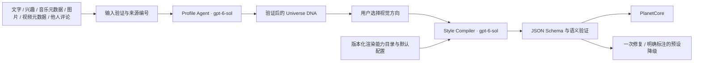

# PersonaVerse 产品理解与 AI 个性化链路

## 产品含义

PersonaVerse 将用户愿意提供的数字生活片段，解读成一个可探索的个人宇宙。输出是一种开放的艺术表达，不是对真实人格的判断、诊断或 MBTI 替代。歧义、矛盾和不确定性应当留下来，而不是被系统过早消除。

### 当前用户主流程（2026-10-18 调整）

最新比赛演示版：三类常驻素材面板代替单一文本框，分别收集自述/帖子、兴趣/歌曲/乐队、图片/视频文字/他人视角。统一序列化在 `src/ai/draft.ts`，素材类别与来源编号保留，交给 Profile Agent 综合理解。

奶蛙为必要装饰，采用用户选定的 2.5D 方案：`public/mascot/milkfrog.png` 保留原图主体，`PlanetMascot.ts` 合成有限服饰与一件配件，并生成单个清晰名牌。编译器新增经过验证的 RenderSpec.mascot（outfit、accessory、accent、label、meaning）。Profile Agent 在 motifs 中保留重要的具体偏爱或乐队名；Style Compiler 选择组合和解释，不能编造配件枚举或宣称新姿势/任意 3D 生成。角色承载具体兴趣，星球承载整体气质。角色贴于地表、朝向镜头，受地表遮挡且支持点击查看含义。没有新增第三次 LLM 调用，以控制演示延迟。

后续同轮调整：Style Compiler 同时输出 landmarks 小发现，使用 15 类支持图标、短标签、个人含义、对比色、companion/surface 布局意图与 evidenceIds。服务器检查 ID 唯一、邻近角色不超过 3 个、引用来源存在于 DNA。引擎对剩余符号进行确定性的球面最大间距放置；不允许 LLM 直接控制任意坐标或比例。丰富素材推荐 6–8 个，证据少时减少数量，不补造照片或发言。点击显示完整解释，列表选择能聚焦到符号位置。真正生图仍为未来可替换的角色图生产模块，当前没有宣称调用图像模型。

首页由个人描述驱动，不要求用户挑选三个模型。`src/ai/client.ts` 先调用 `/api/profile` 并显示“理解描述”，验证 DNA 后调用 `/api/compile` 并显示“构建标签星球”，成功后直接应用渲染配置。标签来自 DNA.themes，展示解释与不确定性；右侧候选方向来自同一人的 DNA.directions，而不是固定渲染预设。用户可以补充音乐、图片等资料，或修正描述再次解读。切换视觉方向仅重新编译，保持 DNA 和 seed。生成失败保留上一次画面，并显示错误；降级配置明确标示。

Profile Agent 的标签描述人的表达、偏爱、习惯和张力，不是将兴趣复制为模型名称。Style Compiler 的 decisions 把这些标签或关系连接到真正选择的地表、空间层和运动。它使用有限能力目录组合图形；目前仍只有三种内部几何家族，不等于能够生成任意三维物体。用户看到的是自己的标签、标题和视觉方向。

自转、云层独立漂移、星带运动与进动已接入动画循环。根据最新反馈，云层已替换为直接移植的 Greenheck Atmosphere：原版 cloud.png、球壳云精灵采样、simplex 密度与受光方式，改为带种子的确定采样并适配单位星球和视口。没有继续使用早先的透明噪声网格壳；它也不是光线步进的体积散射。星带已改为透明细丝带，新增 dust 稀疏点状轨道。进动和分层速度是引擎行为，模型控制整体自转与流速，不能任意编写每个标签的动画。系统减少动态偏好会默认暂停，用户可继续。旧 `compare=1` 不再暂停产品首页。

两个 LLM 模块共享模型名称，但职责和上下文不同。第一阶段理解内容，第二阶段只处理验证后的 DNA、能力目录和预设示例。没有额外的关键词映射代理、模型自主执行代码或任意着色器生成。

## 1. 输入理解

`src/ai/schemas.ts` 的 ContentSchema 定义统一输入包。`server/pipeline.ts` 给每条来源分配 `posts:0`、`music:0` 等 ID，便于区分依据和联想。

| 输入 | 实际处理 | 避免的推断 |
|---|---|---|
| 文字和兴趣 | 共同语境、反复出现的主题、用户的表达 | 单个词直接决定一个物体 |
| 音乐 | 标题、歌手和提供的元数据；界面支持“标题 — 歌手” | 宣称听过音频、知道未提供的歌词或节奏 |
| 图片 | 附件通过 Responses 的 input_image 发送给配置模型；也支持仅描述 | 从外貌断言人格、识别人物或假定未看到的细节 |
| 视频 | 仅分析标题、字幕描述、标签 | 宣称分析了视频帧或音轨 |
| 他人评论 | 保留为第三方观点，与其他材料一起理解 | 将其当作关于用户的客观结论 |

图片最多三张，每张不超过 2 MB；支持 PNG/JPEG/WebP。仅在点击生成时发送给 provider。远程图片 URL 不由服务端自动抓取。原始图像不会进入第二阶段；来源包里只保留描述、ID 和“是否附图”。

输入中的文字和图片可能包含看似系统指令的内容，提示词明确把它们作为素材处理。没有把这些内容当作开发者提示词拼接。

## 2. Profile Agent → Universe DNA

完整提示词：`server/prompts/profile-agent.md`。

提示词的重点是整体语义、关系和创意联想，而非每种输入各自生成一个部件。它要求：

1. 提炼有依据的主题，并把艺术联想标为 tentative。
2. 解释主题之间的张力或对照；资料不足时不强行制造“矛盾”。
3. 描述情绪氛围、抽象隐喻与象征母题。
4. 提供 2–3 个真正不同的视觉方向，包含空间构图、材质、光线和运动。
5. 选择一个方向，保留其他方向可供用户切换。
6. 明确这只是不完整资料的一种创意解读。

DNA 包括：版本、seed、title、vision、emotionalAtmosphere、themes、contrasts、motifs、directions、selectedDirectionId、intensity 和 uncertainty。它既有经过验证的核心字段，也保留自然语言的表达空间。intensity 是视觉偏好，不是人格评分。

严格 JSON Schema 验证之后，服务端继续验证 seed 不变、方向 ID 唯一、选中方向存在以及引用的来源 ID 确实存在。相同 seed 保证渲染器的程序生成可重现；**不保证重新调用 LLM 时得到相同措辞或相同 DNA**。需要重现时应保存 DNA 与 RenderSpec。

## 3. Style Compiler → RenderSpec

完整提示词：`server/prompts/style-compiler.md`。能力目录：`src/ai/capabilities.ts`。

第二阶段把整段视觉方向编译成引擎实际支持的参数。输入不含 API 密钥或原始用户图片。目录明确描述几何家族、材质的实际能力、轨道形态、动画范围、性能建议和不支持的效果。

- `flowing`：基于 Greenheck 的连续多尺度地形、盆地与分层山脊。
- `tectonic`：粗糙地壳、域扭曲的裂隙和与位移一致的局部发光。
- `faceted`：高细分连续矿物地表、细密层理与矿脉；保留旧枚举以兼容配置，已取消粗三角切面光照。小型矿物端面是可选点缀，默认关闭。

`tectonic` 现由 `geometry.fractures` 的疏密、分流、方向、扰动、宽度、覆盖、深度连续组合，种子展开不规则区域和轴向。旧配置可省略该字段并得到稳定的种子变奏；新 AI 编译必须明确输出，其他家族为 null。实现和实测范围见 `docs/FRACTURE_VARIATION.md`。
- 轨道可以独立选用 `ribbons`、`broken`、`angular`，无需与几何家族固定绑定。
- 大气、轨道、结构、光照、动画和后处理可独立配置；装饰星点默认关闭。

模型只能选目录中的真实模块，不能编造组件名、下载任意模型、输出着色器代码或声明引擎支持折射/体积云。抽象要求超出能力时，必须写明近似方案以及丢失了什么效果。

输出包括 renderSpec、directionId、interpretation、decisions 和 fallbacks。decisions 解释意图如何落到具体模块，不要求暴露模型的内部推理。

验证包括严格字段白名单、枚举、数值范围、颜色格式、恰好三种颜色、seed 和方向保持一致、style/geometry 家族一致以及主几何启用。配置错误允许一次修复。两次验证均失败才使用内置预设，并返回 `degraded: true`，界面明确展示降级；连接失败、权限不足和拒绝响应不会被伪装成成功的个性化结果。

## 4. 接口与运行

| 路径 | 含义 |
|---|---|
| `POST /api/profile` | 输入内容，输出验证后的 DNA |
| `POST /api/compile` | 输入 DNA，输出编译结果；用于切换候选方向 |
| `POST /api/universe` | 顺序执行完整两阶段链路 |
| `GET /api/capabilities` | 只读能力目录，不暴露配置 |
| `GET /api/health` | 服务状态与配置模型名，不代表连通性测试 |

开发模式通过 Vite 服务端中间件提供接口；生产模式 `npm start` 同时提供构建文件和接口。服务仅监听 `127.0.0.1`，不是公开部署。请求大小限制为 9 MB，同时最多执行两条生成链路。没有用户数据库、账号系统或生产级配额系统。

默认模型固定为用户指定的 `gpt-6-sol`，而不是配置文件里的 Codex 桌面模型。服务端读取用户授权的本地配置，不修改原文件、不复制密钥到源码、不把它发给浏览器。请求使用 `store:false`；这不等于对第三方 provider 数据保留策略作保证。

## 5. 验证证据与当前边界

`docs/ai-smoke-result.json` 是一次真实 provider 调用结果：虚构资料 → 三个候选方向 → 通过验证的 CRYSTAL/faceted 配置，`degraded:false`，约 47 秒。端到端 UI 流程另外实测，见实现报告。

已实现可运行的初版个性化链路，但当前视觉词汇仍然只有三种几何家族。能力目录、提示词和验证器需要随着真正实现的新模块同步升级，不能仅通过修改提示词假装增加能力。

官方接口约定参考：

- https://developers.openai.com/api/docs/guides/structured-outputs
- https://developers.openai.com/api/reference/resources/responses/methods/create
- https://developers.openai.com/api/docs/models/gpt-6-sol

官方文档用于核对 Responses 与结构化输出格式；MuzeAI 的实际兼容性由本次真实调用确认，不由官方 OpenAI 文档替第三方服务担保。
