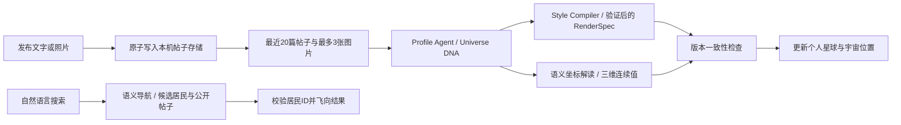

# PersonaVerse 社交宇宙 · 本机演示

## 实现范围

这版把同一个个人星球渲染引擎接入多居民宇宙。17 位居民是虚构示例，初始介绍、帖子、星球参数与坐标来自 `src/social/seed.ts`，页面明确标注其来源。初始身份 `you` 也使用示意资料，直到用户自行修改或生成。没有真实陌生人、在线状态、私信送达或自动同意好友的假象。

服务端仅监听 `127.0.0.1:4173`。右上角的身份切换通过本机保存的 ID 和 `X-Personaverse-Profile` 演示双方操作，不是认证系统。此原型适用于同机展示；上线多人服务需要账号鉴权、数据库与权限、内容管理等独立工作。

## 四个相连的视角

- 宇宙漫游：远景星球使用轻量程序地表、大气与星环，近景选中的星球切换为已有的真实 RenderSpec 地形、云、结构、奶蛙及符号模块。只为当前选中星球分配细节模型。
- 星图：滚轮拉远会同时改变镜头高度，并将透视投影连续混合到正交俯视投影。拖动有阻尼，松手保留逐渐衰减的惯性；鼠标靠近边缘可缓慢平移。列表、总览、回家及缩放按钮提供替代操作。尊重系统减少动态设置。
- 相遇：悬停或选择星球显示双方距离、创意共鸣指数、共同主题和开场建议；点击标签或列表平滑靠近。搜索使用完整描述、介绍、标签与最近公开帖子的语义匹配，返回可核对的理由和一句建议问题，不会自动发送消息。
- 轨道日记：通过朋友圈按钮大幅靠近，让星球超过画面。最近九篇日记仅在这一视角投影到面向镜头的球面坐标，点击展开正文和照片；完整时间线保留全部帖子，按时间倒序显示。Esc 返回，支持点赞和发布文字/照片。

## 数据与 AI 流程

文本模型默认沿用 `gpt-6-sol` 的现有服务端配置。音乐可写在帖子里，由模型结合上下文理解标题、艺人等文字，不分析音频。图片按已有多模态路径提交；无需图片也能更新。AI 调用独立于帖子保存，耗时不会阻止继续看帖、探索或刷新。工作室另支持分类输入音乐、视频说明等，并可发布 DNA 与 RenderSpec；发布不会把素材草稿伪造为朋友圈帖子。

新增的 `social-signature.md` 根据整体 DNA 解释表达能量、探索倾向、相处温度三个连续艺术维度，保留不确定性，禁止把兴趣机械映射为固定分数。场景坐标为：

`x = (exploration − 0.5) × 64; y = (energy − 0.5) × 24; z = (warmth − 0.5) × 64`

场景单位定义为虚拟光年，双方距离是坐标的欧氏距离。共鸣指数为 `round(100 × exp(−distance / 32))`，与物理距离一致、单调变化。这是有限维度的创意导航，不能完整测量人的性格，也不代表真实天文尺度或关系成功概率。默认示例坐标由开发者编排；成功进行 AI 更新或工作室发布后再进行 AI 坐标解释。

`social-navigation.md` 整体解释搜索意图，参考每位居民最近三篇公开帖子，要求尊重否定词、只引用候选 ID、给出具体依据、不虚构共同经历。返回的未知或重复 ID 会移除。语义服务不可用时，明确标记为「本地文字匹配」，不把简单匹配伪装成语义理解。

## 留存、请求与失败处理

- `server/social-store.ts` 将读写排队，临时文件原子替换 `.local/social-universe.json`，避免并发写入丢失帖子或关系。
- 每篇帖子独立保存 ID、作者、正文、照片、时间与点赞者。PNG/JPEG/WebP 单张小于 2 MB，服务端拒绝外部图片 URL。
- 好友请求只允许向另一居民发起。待处理或已接受关系不重复创建，只有接收方身份能接受/婉拒。接受才出现在好友列表；可从列表再次导航星球。
- 更新最多同时处理两位居民，同一居民不重复运行。帖子/资料有版本号；分析期间发布新帖、修改介绍或发布新工作室星球时，过期结果无法覆盖新的状态。
- AI 编译失败不替换原星球，也不删除帖子；页面保留重试入口。工作室发布后的坐标推断失败时保留原坐标，并标记状态。
- 同一浏览器记住当前演示身份；帖子与关系由本机服务端保存，换浏览器仍能读取同一台服务器的数据。没有跨机器同步。
- 更新以最近20篇帖子作为上下文，界面时间线仍留存全部帖子。前三个艺术维度是一版轻量实现，未接入向量数据库或大规模检索服务。

## 文件与验证

`src/social/UniverseCore.ts` 管镜头与 Three.js 场景，`SocialUniverse.tsx` 管交互、朋友圈与好友界面，`model.ts` 给出距离和数据契约。服务端入口为 `server/social.ts`，AI 解释位于 `server/social-ai.ts`。原工作室和 Greenheck 地形/云适配代码继续沿用，出处与许可证见 `THIRD_PARTY_NOTICES.md`；新星图与社交层没有引入完整外部项目模板。

`npm run build`、`npm test` 检查类型和契约；社交测试使用临时目录和模拟 AI，不触碰演示数据或调用收费服务。覆盖距离一致性、虚构标识、并发持久化、请求接收权限、重复请求、点赞、失败保留、过期结果拒绝，以及搜索 ID 校验和明确降级。

2026-10-18 在本地浏览器实际验证了：自然语言「性格温柔」返回语义理由并定位；发送好友请求、切换对方身份接受并在重载后恢复；发布一篇明确标注的虚构日记，经实际 AI 处理后，居民 `morrow` 的 `source` 变为 `ai` 且 `revision = analyzedRevision = 1`。原帖仍保留。这些演示数据保存在被 Git 忽略的 `.local/`，不随仓库上传。截图和浏览器检查不能替代真实多人负载或正式认证验证。
